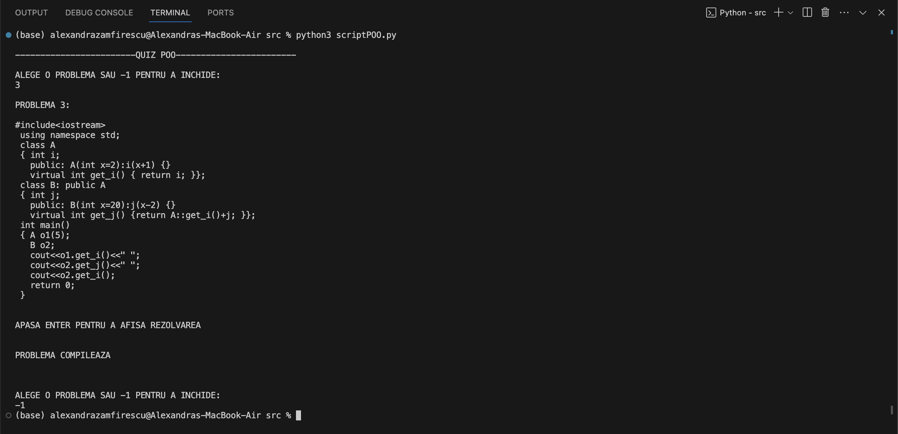

# OOP

### Notare
**Nota finala** = **25% pe 3 proiecte** + **25% colocviu** + **50% test scris** (minim 5 la toate 3), maxim 2 pct bonus la nota pe proiecte de catre tutorele de lab

## [OOP Project - MOOSIC](https://github.com/zamfiresq/MOOSIC)

## OOP QUIZ
Acest script te ajuta sa rezolvi programe asemanatoare cu cele intalnite la examen, pentru a intelege cum se compileaza si ruleaza.

### Utilizare
In directorul `src` se afla scriptul si cele 100 de fisiere care contin programele. Din interiorul directorului `src`, ruleaza:
`python3 scriptPOO.py`

